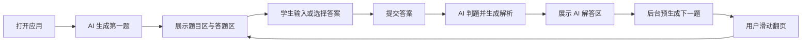

# 小学 AI 做题 App — 实现需求文档

## 1. 项目目标

开发一款面向小学生的移动端做题 App，覆盖 **语文、数学、英语** 三个学科。

应用以“单题单页”为核心学习流程：每次进入应用或翻到下一页时，由 AI 自动生成一道符合小学阶段的题目；学生作答并提交后，AI 立即给出判定、解析与知识点提示，随后学生可右滑翻到下一题。

> [!IMPORTANT]
> AI 生成的内容必须限定在小学知识范围内，表达应简洁、友好、适龄，不得生成成人内容、危险内容或超出小学课程难度的题目。

---

## 2. 目标用户与使用场景

- **目标用户**：小学 1–6 年级学生，以及陪同学习的家长。
- **核心场景**：学生打开 App 后即可开始答题，不需要复杂配置。
- **学习节奏**：看题 → 输入答案 → 提交 → 查看 AI 解析 → 右滑进入下一题。

---

## 3. 功能范围

### 3.1 学科与题目范围

首版支持以下学科：

- **语文**
  - 拼音、汉字、词语、成语、近反义词
  - 句子补全、病句辨析、阅读理解（短文本）
  - 古诗词填空、基础文学常识
- **数学**
  - 四则运算、分数、小数、单位换算
  - 应用题、几何图形、时间与人民币
  - 基础逻辑与规律题
- **英语**
  - 字母、单词、简单句型
  - 单词拼写、词义匹配、句子填空
  - 简短阅读理解与基础语法

题目难度按小学 1–6 年级划分。首版默认使用“适中”难度，并在生成请求中带上年级、学科、题型等上下文。

### 3.2 单题页面结构

每一页只展示一道题，页面从上到下分为三个固定区域：

1. **题目区**
   - 展示学科、年级/难度、题型标签。
   - 展示题干；数学题可使用公式排版，语文和英语题支持富文本。
   - 如为选择题，展示选项；如为填空/简答题，展示作答提示。

2. **答题区**
   - 根据题型展示合适的输入方式：
     - 单选题：单选按钮或选项卡。
     - 多选题：多选按钮。
     - 填空/计算题：文本输入框。
     - 简答题：多行文本输入框。
   - 提供“提交答案”按钮。
   - 未提交前允许修改答案。
   - 空答案点击提交时，给出明确提示，不调用 AI 判题。

3. **AI 解答区**
   - 未提交前显示“完成作答后，AI 会为你讲解”。
   - 提交后立即进入加载状态，例如“AI 正在检查并讲解…”。
   - AI 返回后展示：
     - 判定结果：正确 / 需要再想想。
     - 正确答案。
     - 分步骤解析。
     - 涉及知识点。
     - 鼓励性学习建议（简短、正向）。
   - 已提交后锁定当前答案，避免答案与解析不一致。

### 3.3 AI 出题

触发时机：

- 用户首次打开应用时，自动生成第一题。
- 用户成功翻到下一题时，自动生成下一题。
- 生成失败时，允许点击“重新生成”。

生成要求：

- 返回结构化数据，不能只返回自然语言。
- 每次仅生成 1 道题。
- 题目包含标准答案与参考解析，供本地展示和后续 AI 判题使用。
- 尽量避免短时间内出现相同题目或高度相似题目。
- 应随机轮换语文、数学、英语；若后续加入学科筛选，则优先遵循用户所选学科。

建议 AI 出题结果模型：

```json
{
  "id": "uuid",
  "subject": "MATH",
  "grade": 3,
  "difficulty": "MEDIUM",
  "type": "SINGLE_CHOICE",
  "stem": "小明有 24 支铅笔，平均分给 6 个同学，每个同学有几支？",
  "options": ["3", "4", "5", "6"],
  "correctAnswer": "4",
  "answerExplanation": "24 ÷ 6 = 4，所以每个同学有 4 支铅笔。",
  "knowledgePoints": ["表内除法", "平均分"],
  "sourcePromptVersion": "v1"
}
```

> [!NOTE]
> `correctAnswer` 和 `answerExplanation` 不应在用户提交前显示到界面，但可以保存在当前题目状态中，供后续判题与 AI 解析使用。

### 3.4 AI 判题与解析

用户点击“提交答案”后，调用 AI 对当前作答进行评估。

AI 输入至少包括：题干、选项、标准答案、用户答案、年级、学科、题型。

AI 输出必须为结构化数据：

```json
{
  "isCorrect": false,
  "correctAnswer": "4",
  "analysis": [
    "这道题要求把 24 支铅笔平均分成 6 份。",
    "用除法计算：24 ÷ 6 = 4。",
    "所以每个同学有 4 支铅笔。"
  ],
  "knowledgePoints": ["表内除法", "平均分"],
  "encouragement": "你已经知道要用除法了，再仔细算一算就能答对！"
}
```

判题规则：

- 对客观题（选择、填空、计算）优先使用本地标准答案进行确定性比对。
- 对主观题（语文简答、英语造句等）再交给 AI 语义判定。
- 即使本地已能判断对错，仍需展示 AI 的适龄解析。
- 解析不得只说“正确/错误”，必须说明解题思路。

### 3.5 右滑翻页与题目预加载

- 已完成当前题目的提交和解析展示后，用户可**从右向左滑动**进入下一题（即内容向左移动的常见“右滑翻页”手势效果）；如产品定义为“手指向右滑”，实现时需统一交互方向并在 UI 中明确引导。
- 翻页应使用明显但不过度的横向切换动画，例如类似 Pager 的滑动/淡入缩放效果。
- 当前题尚未提交时，禁止翻到下一题，或弹窗提示“请先完成并提交本题”。
- 在当前题解析展示完成后，即刻开始后台预生成下一题，减少用户翻页后的等待。
- 若预生成未完成，翻到下一页后显示加载骨架或加载状态，完成后自动展示题目。
- AI 调用失败、网络不可用、结构化数据不合法时，展示错误状态和“重新生成”按钮，不应导致页面卡死。

---

## 4. 主要用户流程



### 4.1 页面状态

每题至少需要以下状态：

- `Generating`：AI 正在生成题目。
- `Ready`：题目已加载，等待用户作答。
- `Answering`：用户正在输入或选择答案。
- `Checking`：已提交，AI 正在判题和生成解析。
- `Explained`：已显示解析，可翻页。
- `Error`：题目生成或解析失败，可重试。

---

## 5. UI / UX 要求

### 5.1 整体风格

- 面向小学生，视觉应明亮、清晰、有趣，但避免过度装饰和干扰学习。
- 使用大字号、清晰的行高、足够的点击区域。
- 颜色需要有良好对比度，关键信息不能只依赖颜色传达。
- 在加载时提供明确反馈；AI 响应时间较长时不能呈现空白界面。

### 5.2 建议页面布局

- 顶部：学科标签、年级/难度标签、当前题目序号（例如“第 3 题”）。
- 中部上方：题目卡片（题目区）。
- 中部下方：答案输入或选项（答题区）。
- 底部：提交按钮；提交后扩展/显示 AI 解答卡片（AI 解答区）。
- 解答完成后：展示“左滑下一题”的引导文字或箭头。

### 5.3 交互细节

- 提交后按钮应防重复点击。
- AI 解析较长时，解答区应可滚动，不能遮挡翻页手势或系统导航区域。
- 切换题目后应将新题滚动位置重置到顶部。
- 题目、答案和解析应支持状态保存，避免旋转屏幕或短暂切后台后丢失当前作答。

---

## 6. Android 实现建议

### 6.1 推荐技术栈

- Kotlin
- Jetpack Compose + Material 3
- ViewModel + `StateFlow` 管理 UI 状态
- Kotlin Coroutines 管理 AI 网络请求与预加载任务
- `HorizontalPager` 实现横向分页和翻页动画
- Repository 层封装 AI 出题、判题接口
- 依赖注入可沿用项目现有方案；若项目尚未引入，可使用 Hilt

### 6.2 推荐核心数据模型

```kotlin
enum class Subject { CHINESE, MATH, ENGLISH }
enum class QuestionType { SINGLE_CHOICE, MULTI_CHOICE, FILL_BLANK, SHORT_ANSWER }
enum class QuestionStatus { GENERATING, READY, CHECKING, EXPLAINED, ERROR }

data class QuizQuestion(
    val id: String,
    val subject: Subject,
    val grade: Int,
    val difficulty: String,
    val type: QuestionType,
    val stem: String,
    val options: List<String> = emptyList(),
    val correctAnswer: String,
    val answerExplanation: String,
    val knowledgePoints: List<String>
)

data class AiExplanation(
    val isCorrect: Boolean,
    val correctAnswer: String,
    val analysis: List<String>,
    val knowledgePoints: List<String>,
    val encouragement: String
)

data class QuizPageState(
    val question: QuizQuestion? = null,
    val userAnswer: String = "",
    val explanation: AiExplanation? = null,
    val status: QuestionStatus = QuestionStatus.GENERATING,
    val errorMessage: String? = null
)
```

### 6.3 AI 服务接口职责

```kotlin
interface QuizAiRepository {
    suspend fun generateQuestion(request: GenerateQuestionRequest): QuizQuestion
    suspend fun evaluateAnswer(request: EvaluateAnswerRequest): AiExplanation
}
```

- `generateQuestion`：强制 AI 返回符合 schema 的单题 JSON。
- `evaluateAnswer`：结合用户答案与参考答案，返回符合 schema 的解析 JSON。
- Repository 要负责：超时、网络异常、JSON 解析失败、内容校验和错误转换。
- API Key 不得硬编码在客户端；应通过安全后端代理 AI 请求，或使用项目批准的安全密钥管理方案。

> [!WARNING]
> 若直接在 Android 客户端内嵌云端 AI 服务密钥，应用发布后密钥容易被提取和滥用。生产环境应由后端持有密钥并校验请求。

---

## 7. AI Prompt 约束

### 7.1 出题 Prompt 关键要求

- 角色：小学教师。
- 学科：指定语文 / 数学 / 英语。
- 年级：指定 1–6 年级。
- 只生成 1 题。
- 难度适中，题干简洁，无歧义。
- 仅返回约定 JSON，禁止 Markdown、前后说明或代码块。
- 选择题必须给出 2–4 个合理选项，且标准答案必须能对应选项。
- 解析必须为小学生能理解的分步骤说明。
- 避免最近题目的重复主题、数值和文本。

### 7.2 判题 Prompt 关键要求

- 根据当前题目、标准答案与用户答案进行判定。
- 使用鼓励、清晰、适龄的语言；不批评、不羞辱。
- 对错题重点说明正确思路，不泄露与题目无关内容。
- 仅返回约定 JSON。
- 主观题答案存在合理表达时，允许给出部分肯定并指出可改进之处。

---

## 8. 非功能要求

### 8.1 性能与稳定性

- 题目生成、判题和下一题预加载必须在非主线程执行。
- 所有 AI 请求需设置合理超时和重试策略。
- 同一请求进行中时，避免重复发起。
- 翻页和输入必须保持流畅，不因网络请求阻塞 UI。

### 8.2 网络与错误处理

- 无网络：提示“网络不可用，请检查后重试”。
- 服务超时：提示“AI 响应较慢，请重新尝试”。
- AI 返回内容不符合结构：记录错误并重新请求一次；仍失败则展示重试入口。
- 解析失败：保留学生答案与题目，允许单独“重新获取解析”。

### 8.3 隐私与内容安全

- 不要求学生输入真实姓名、电话、住址等个人信息。
- 如记录学习数据，需明确告知用途并遵循隐私政策。
- 对 AI 输入输出做内容过滤，确保适龄。
- 不在日志中记录完整的个人答案、API 密钥或敏感信息。

---

## 9. 验收标准

满足以下条件即认为首版需求完成：

1. 打开 App 后会自动请求并展示一道小学题目。
2. 每页清晰包含题目区、答题区、AI 解答区。
3. 支持至少单选题和填空题；可扩展至简答题。
4. 用户提交后，界面会显示 AI 判题加载状态，并展示对错、正确答案、解析、知识点和鼓励语。
5. 未提交答案时不能进入下一题。
6. 已完成解析后可通过横向滑动动画进入下一题。
7. 进入下一题时自动生成或展示已预加载的下一题。
8. 断网、超时、AI 返回格式错误时有可见错误提示和重试操作。
9. 题目难度、内容和语言符合小学语文、数学、英语范围。
10. 旋转屏幕或临时切后台后，当前题目、答案和已获得的解析不会丢失。

---

## 10. 后续可选迭代（不属于首版必做）

- 年级、学科、难度筛选。
- 错题本与收藏题目。
- 学习进度、正确率和知识点薄弱项统计。
- 家长模式与每日学习目标。
- 语音读题、语音作答。
- 图片题与拍照识题。
- 本地题库兜底，弱网时继续练习。
- 激励体系，例如连续答题天数、勋章和成长树。
